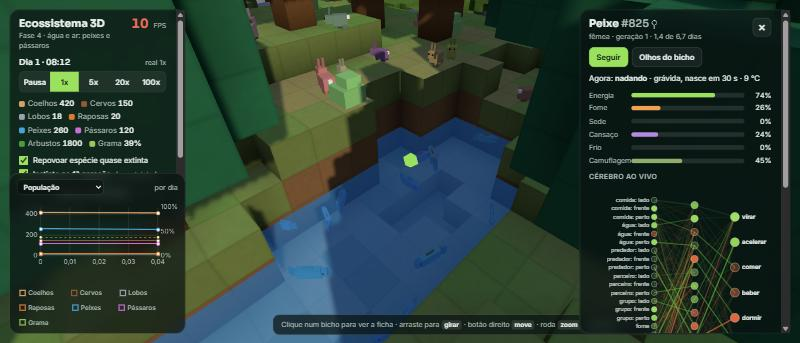
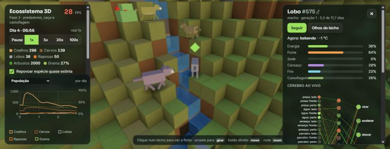
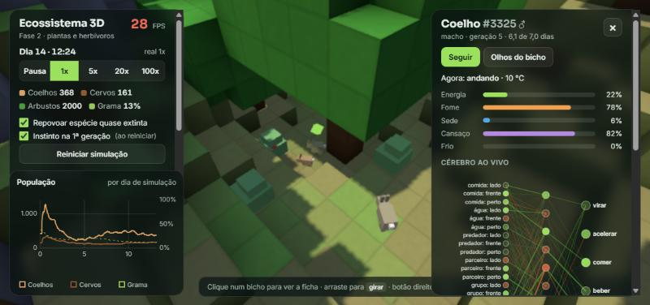
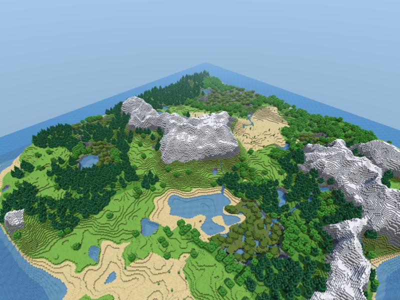

# Ecossistema 3D

Simulador de ecossistema em 3D que roda no navegador, com visual de blocos (voxels).
Os seres vivos têm **genes** e um **cérebro de rede neural** que evoluem por **seleção natural**:
ninguém programa o comportamento deles; os cérebros e corpos que funcionam melhor simplesmente deixam mais filhos.

A arte é 100% original: blocos com cores planas, variação de tom e contorno feitos no shader, sem texturas de outros jogos.

> **Status:** Fase 4 de 6 concluída: mundo 3D, plantas e algas, coelhos, cervos, lobos, raposas,
> peixes (nadam em 3D) e pássaros (voam e pousam), com caça, fuga, camuflagem e ciclos predador-presa.









## Como rodar

Pré-requisito: [Node.js](https://nodejs.org) 20 ou mais novo.

```bash
npm install
npm run dev        # abre em http://localhost:5173
npm test           # testes unitários (Vitest)
npm run build      # versão de produção em dist/
```

Dá para escolher o mundo pela URL: `http://localhost:5173/?seed=ilha-azul`.
A mesma seed sempre gera o mesmo mundo.

### Controles

| Modo | Ação |
|---|---|
| Órbita | arrastar = girar · botão direito = mover · roda = zoom · `W A S D` = andar pelo mapa |
| Voo livre | arrastar = olhar · `W A S D` = voar · `Espaço`/`Q` = subir/descer · `Shift` = rápido · roda = velocidade |
| Criaturas | **clique** num bicho para abrir a ficha · "Seguir" · "Olhos do bicho" (primeira pessoa) |
| Geral | `F` alterna órbita/voo · `T` pausa · `Esc` sai dos olhos do bicho / fecha a ficha |

## Arquitetura

```
src/
├─ core/        RNG com seed e funções matemáticas (sem dependências)
├─ world/       blocos, biomas, geração do terreno, grade de voxels, greedy meshing
├─ sim/         a simulação: rede neural, genoma, espécies, plantas, criaturas, relógio
├─ workers/     Web Workers (mundo e simulação) e os protocolos de mensagens
├─ render/      Three.js: chunks, céu/dia-noite, câmera, criaturas e arbustos instanciados
├─ ui/          painel, gráfico de população (uPlot), ficha da criatura, desenho do cérebro
└─ main.ts      liga tudo e roda o laço de renderização
tests/          testes unitários da lógica (sem navegador)
prototipo/      protótipo 2D original (a origem das ideias de evolução)
```

**Princípio central: separar lógica de desenho.** Tudo em `core/`, `world/` e `sim/` é TypeScript puro,
sem DOM nem Three.js, por isso roda tanto no navegador quanto nos testes. A thread principal só desenha;
o trabalho pesado acontece em Web Workers, então a tela não congela nem quando o tempo está em 100x.

```
 thread principal (60 fps)                 workers do MUNDO (2 a 4, em paralelo)
 ┌──────────────────────────┐    seed     ┌───────────────────────────────┐
 │ Three.js: chunks, céu,   │ ──────────▶ │ gera o mundo pela seed        │
 │ criaturas instanciadas,  │ ◀────────── │ faz a malha de 1/N dos chunks │
 │ HUD, gráfico, ficha      │   malhas    └───────────────────────────────┘
 │                          │
 │ interpola as posições    │    seed     worker da SIMULAÇÃO
 │ entre os quadros         │ ──────────▶ ┌───────────────────────────────┐
 │                          │ ◀────────── │ recria o mundo pela seed      │
 └──────────────────────────┘   ~20×/s    │ plantas, cérebros, evolução   │
                              12 números  │ roda N passos conforme a      │
                              por bicho   │ velocidade (1x a 100x)        │
                                          └───────────────────────────────┘
```

**Truque de paralelismo:** como a geração é determinística, cada worker gera o mundo inteiro sozinho
(~0,7 s) em vez de recebê-lo. Assim não é preciso mandar 25 MB de voxels entre threads.
As criaturas viajam como um `Float32Array` "achatado" (12 números por bicho), *transferido* sem cópia.

## Como o mundo é gerado

O mundo tem 512 × 512 × 96 blocos (~25 MB, 1 byte por bloco), dividido em 256 chunks de 32 × 32.

1. **Altura**: soma de ruído simplex em várias escalas (fBm). Um ruído de baixa frequência define continentes;
   um ruído "ridged" (`1 − |ruído|`, elevado ao cubo) forma as cristas das montanhas.
2. **Borda**: uma máscara leva a altura para baixo perto das bordas → o mapa é uma ilha cercada de oceano profundo.
3. **Temperatura e umidade**: mais dois ruídos independentes; a temperatura cai com a altitude.
4. **Biomas**: oceano, praia, planície, floresta, montanha (neve no alto), deserto e pântano.
5. **Lagos**: regiões planas onde um ruído passa de um limiar; o fundo é escavado e as margens viram diques.
6. **Rios**: nascem nas montanhas e descem escolhendo o vizinho de menor `altura + distância até o mar`
   (distância calculada por busca em largura a partir do oceano). O nível da água só desce; se o caminho sobe,
   o terreno é escavado, formando cânions.
7. **Árvores** por bioma: carvalhos, pinheiros, árvores de pântano e cactos.

## Como a simulação funciona

A simulação anda em passos de 0,2 s de "tempo de simulação"; um dia dura 240 s (4 min em 1x).
A cada passo, cada criatura:

1. **Sente** o mundo e preenche as 23 entradas do cérebro.
2. **Pensa**: as entradas passam pela rede neural (23 → 14 → 7).
3. **Age** conforme as 7 saídas: virar, acelerar, comer, beber, dormir, acasalar, subir/descer.
4. **Gasta energia**: metabolismo, movimento (∝ massa × velocidade²), cérebro e olhos.
5. Pode **acasalar**, **parir**, **caçar** ou **morrer** (fome, sede, frio, velhice, predação).

Todas as espécies usam o mesmo cérebro. Para um predador, a entrada "comida" é a **presa** visível mais próxima
(ou uma carcaça) e a saída "comer" é **atacar**.

### O cérebro

```
 23 entradas (sentidos)               14 ocultos (tanh)      7 saídas (decisões)
 comida/água/parceiro/grupo:            ●                     virar
   [lado, frente, perto]                ●                     acelerar
 predador mais próximo                  ●                     comer (ou atacar)
 fome, sede, cansaço, frio, noite  ──▶  ●   ──────────────▶   beber
 subida à frente, bloqueado             ●                     dormir
 constante (viés)                       ●                     acasalar
                                                              subir/descer (peixes e pássaros)
```

Para quem nada ou voa, a entrada "subida à frente" vira **altura** (fundo/pousado = -1, superfície/alto = +1).

- As direções são **relativas à cabeça do bicho**: seno do ângulo até o alvo (está à esquerda ou à direita?)
  e cosseno (está na frente ou atrás?). Por isso uma única ligação "comida à direita → vire à direita" já funciona.
- Os **427 pesos fazem parte do DNA**. Não existe treino por gradiente nem "nota": só seleção natural.
- A ficha da criatura desenha a rede ao vivo: linha verde reforça, laranja inibe, e as bolinhas acendem conforme ela pensa.

### Genes de corpo e seus custos (trade-offs)

| Gene | Vantagem | Custo |
|---|---|---|
| Tamanho | mais reserva, mordida maior, gasta menos por quilo (Kleiber), perde menos calor, passada maior, preferido pelas fêmeas | energia total ∝ tamanho³; sofre mais no calor |
| Velocidade | chega antes na comida e no parceiro | energia ∝ velocidade² |
| Visão | enxerga comida e parceiros de mais longe | custo fixo por bloco de visão |
| Metabolismo | amadurece mais cedo, digere e descansa mais rápido | gasta mais energia parado |
| Resistência ao frio | aguenta noites e montanhas frias | gasto extra e sofre no calor |
| Ninhada | mais filhotes por gestação | cada filhote nasce com menos energia |
| Idade máxima | vive mais | amadurece mais tarde |
| Cor (RGB) | camuflagem: quanto mais parecida com o chão, mais de perto precisa estar para ser notado | — (mas o chão muda de bioma para bioma) |

### Reprodução sexuada

1. Uma fêmea **pronta** (adulta, com energia e água, sem cooldown) e cujo cérebro diz "acasalar" ouve o
   chamado de um macho pronto que também quer acasalar e vai até ele (**corte**). Ela prefere machos
   maiores (**seleção sexual**): um macho 40% maior "vale" tanto quanto um normal à metade da distância.
2. A menos de 4 blocos, ela engravida do maior macho pronto por perto. A gestação dura 50 s (coelho) ou 60 s (cervo).
3. No parto, cada filhote recebe `crossover(mãe, pai) + mutação`:
   - **genes de corpo**: cada gene vem de um dos pais ou é a média dos dois; depois, mutação gaussiana pequena;
   - **cérebro**: o crossover é **por neurônio**, ou seja, cada neurônio oculto vem inteiro de um dos pais
     (pesos de entrada e de saída juntos). Assim um "detector" que funciona passa intacto para o filho.
4. A mãe investe 50% da energia, dividida entre os filhotes da ninhada.

### Plantas e cadeia alimentar

- **Grama**: um valor 0..1 por bloco de chão, que cresce de forma logística conforme fertilidade, umidade e luz.
  O chão fica marrom-palha onde os bichos comeram (o shader do terreno lê uma textura vinda da simulação).
- **Arbustos**: dão frutas vermelhas (comida forte) e espalham sementes.
- **Folhas de árvore** (ramoneio): só o cervo alcança. Esse **nicho separado** evita que os coelhos,
  que pastam rente, deixem os cervos sem comida.

### Predadores, caça e fuga

| Espécie | Caça | Detalhes |
|---|---|---|
| Lobo | cervos e coelhos | vive em alcateia; cervo é grande e se defende, então caçar em grupo compensa |
| Raposa | coelhos | **onívora**: come frutas quando está com fome e não acha presa |

- **Ataque**: com a presa ao alcance e a saída "atacar" ligada, cada tentativa (uma a cada 1,2 s, custa 1% da energia) acerta com
  chance `0,4 × √(massa do predador / massa da presa)` **+ 15% por companheiro de alcateia atacando junto** (até 3)
  **+ 40% se a presa está dormindo**. Assim a caça em grupo pode evoluir: o cérebro tem a entrada "grupo" e a evolução
  decide se vale a pena andar junto.
- **Carcaça**: a presa morta vira carne (400 de energia por unidade de massa) que qualquer lobo/raposa pode comer e que
  apodrece em 150 s. Um cervo alimenta a alcateia inteira.
- **Fuga**: as presas sentem o predador visível mais próximo (lado, frente, distância). O instinto inicial tem
  "predador de um lado → vire para o outro" e "predador perto → corra e acorde".
- **Camuflagem**: cada bloco do chão tem uma cor. A camuflagem de um bicho é 1 quando a cor dele (genes R, G, B) é igual à
  do chão onde está e 0 quando a diferença passa de 0,5. Ela reduz em até **60%** a distância em que ele é notado.
  **Andar rápido denuncia**: em movimento, a camuflagem vale só 40%. Vale para os dois lados: predador camuflado também
  chega mais perto sem ser visto.
- **Amamentação**: filhotes de qualquer espécie, na primeira metade da infância e a menos de 8 blocos da mãe, recebem
  energia dela (até 0,5% da reserva da mãe por segundo); filhote pequeno segue a mãe. Sem isso, filhotes de predador,
  que ainda não sabem caçar, morriam todos de fome.

### Água e ar: peixes, algas e pássaros (Fase 4)

Cada espécie tem um **meio**: terra (anda), água (nada em 3D) ou ar (voa e pousa).

- **Algas** crescem no fundo da água rasa (1 a 8 blocos de profundidade), de forma logística, mais de dia.
  O fundo fica verde-escuro conforme a quantidade (o mesmo truque de textura da grama, num segundo canal).
- **Peixes** nadam em 3D: a saída "subir/descer" muda a altura entre o fundo e a superfície, e eles nunca saem da
  água (a margem bloqueia, e a entrada "bloqueado à frente" avisa). Comem algas, e **peixe grande come peixe pequeno**
  (menor que 70% do tamanho dele), então o tamanho do corpo vira uma corrida armamentista dentro da própria espécie.
  Sangue frio: gastam menos, não passam sede e a água varia menos de temperatura.
- **Pássaros** voam (bater asas custa energia), sobem e descem pela saída "subir/descer" e **pousam** ao tocar a copa
  das árvores ou o chão (nunca na água). Comem frutas só pousados e **pescam** peixes que chegam a menos de 1,5 bloco
  da superfície. Ficam **vulneráveis só quando pousados no chão**: lobos e raposas não alcançam um pássaro voando nem
  pousado no alto de uma árvore. Por isso a evolução pode favorecer dormir nas copas.
- Instinto inicial extra: "longe da altura confortável → corrija" (peixe no meio da água, pássaro a ~10 blocos) e
  "comida perto, cansaço ou noite → descer" (o pássaro pousa para comer e dormir).

Resultado numa rodada de 25 dias com as 6 espécies (repovoamento ligado): todas convivem até o fim, mas os primeiros
dias são turbulentos. Os peixes nascem demais no dia 1 (cerca de 1.100 ovos), esgotam as algas locais e caem para ~40,
depois estabilizam entre ~60 e ~125; os pássaros caem para 6 e se recuperam para ~65–85. O repovoamento entrou
9 vezes em 25 dias (contra 4–6 em 40 dias na Fase 3): com mais espécies competindo, o sistema oscila mais.
Reduzir esse "pico e colapso" inicial é um ajuste pendente para a Fase 6.

### Instinto inicial e repovoamento

- Com cérebros 100% aleatórios, quase todos os bichos giram em círculos e morrem, e o cervo, que se reproduz devagar,
  não tem tempo de evoluir. Por isso a **primeira geração** nasce de um "ancestral primitivo": algumas ligações simples
  escritas à mão ("fome + comida perto → comer", "cansado + noite → dormir", "predador perto → fugir",
  e para predadores "presa perto e fome → perseguir") mais ruído aleatório.
  Depois disso, tudo é seleção natural. Dá para desligar no painel e comparar.
- **Repovoamento** (pode desligar): se uma espécie cai abaixo de 6 indivíduos, dois bandos novos são soltos a partir
  dos **melhores genomas já vistos** daquela espécie (mais filhos deixados).

### Números do equilíbrio (e por quê)

Ajustados rodando a simulação sem tela por 30 a 60 dias simulados e olhando populações, mortes e genes:

| Parâmetro | Valor | Motivo |
|---|---|---|
| Reserva de energia | 300 × massa | um adulto parado aguenta ~1,5 dia sem comer |
| Crescimento da grama | 0,2%/s | sustenta algumas centenas de coelhos; com mais, a grama acaba e eles passam fome |
| Arbustos | máx. 2.000, fruta a cada 90–150 s | com 4.500 arbustos as frutas alimentavam ~1.500 coelhos (explosão) |
| Folhas (ramoneio) | rebrota 0,8%/s, raio 4 em volta das árvores | com 0,4%/s sustentavam só ~50 cervos; com 1,2%/s os cervos explodiam |
| Altura mínima de pastejo | coelho 0, cervo 0,3 | o coelho rói a grama rente; o cervo só aproveita grama alta |
| Bandos iniciais | 12 coelhos / 15 cervos | espalhados, os pares quase nunca se encontram |
| Chamado de acasalamento | 3 × visão | populações ralas somem por não se encontrarem (efeito Allee) |
| Metabolismo basal | ∝ massa^0,75 (lei de Kleiber) | bicho grande gasta menos por quilo |
| Custo fixo do cérebro/olhos | 0,1 + 0,004 × visão | não diminui se o corpo encolher |
| Seleção sexual | fêmea prefere macho maior | contrapeso real ao encolhimento |
| Metabolismo basal dos predadores | 30% do dos herbívoros | passam muito tempo parados entre refeições; com 100% morriam de fome entre caçadas |
| Carne | 400 por unidade de massa da presa | um coelho rende ~1 dia de raposa; com 60% da reserva da presa, lobos não se sustentavam |
| Movimento | 0,25 × massa × (v/5)² | perseguir no máximo custava ~9/s para um lobo grande |
| Parto dos predadores | 30% da energia da mãe, ninhada 3, gestação 90 s (lobo) / 70 s (raposa) | com ninhada 4 e gestação curta, os lobos explodiam e colapsavam |
| Amamentação | 0,5%/s por filhote, até 35%; só com a mãe acima de 30% | com 2%/s até 70%, a ninhada matava a mãe de fome |
| Frutas para a raposa | só abaixo de 50% de energia, eficiência 0,5 | comendo à vontade, as raposas ficavam numerosas mesmo sem coelhos e os extinguiam |

**Ciclos predador-presa (Fase 3).** Com o repovoamento ligado (o padrão), aparecem os ciclos de Lotka-Volterra com o
atraso clássico. Exemplo de 40 dias: os cervos sobem de 106 para 486, os lobos sobem atrás (9 → 235), os cervos
despencam para 127 e os lobos caem em seguida. O repovoamento entrou 4 a 6 vezes em 40 dias (~1 por semana).

**Limitação honesta:** com o repovoamento **desligado**, as oscilações são grandes demais para um mundo finito e, na maioria
das sementes testadas, alguma espécie some entre os dias 10 e 25 (às vezes os lobos comem todos os cervos e depois morrem de
fome). É a mesma instabilidade dos experimentos clássicos de Gause com protozoários. Amortecer isso sem rede de segurança
(refúgios para presas, predadores que trocam de presa, territórios) é um bom próximo passo.

### Fenômenos que apareceram sozinhos (e como cada um foi resolvido)

O balanceamento foi feito rodando a simulação sem tela e olhando os números. Vários comportamentos
apareceram sem ninguém programar:

- **Nanismo**: com todos os custos proporcionais à massa, os coelhos encolheram de 1,0 para 0,57 em 60 dias,
  porque ser pequeno saía "de graça" (na biologia: nanismo insular). Custo fixo do cérebro, regra de Bergmann,
  lei de Kleiber e seleção sexual reduziram isso: na versão final, 1,0 → 0,83 em 30 dias. Ainda há uma leve
  tendência a encolher; os predadores da Fase 3 (que pegam mais fácil os pequenos) devem completar o equilíbrio.
- **Exclusão competitiva**: quando coelhos e cervos comiam a mesma grama, uma espécie sempre eliminava a outra
  (às vezes os coelhos, às vezes os cervos). Separar os nichos (folhas de árvore e grama alta para o cervo, grama rente
  para o coelho) permitiu a convivência.
- **Efeito Allee**: com poucos cervos espalhados pela floresta, quase nenhuma fêmea pronta tinha um macho pronto a menos
  de 40 blocos. A população caía mesmo com comida sobrando. O chamado de acasalamento e a corte resolveram.
- **Explosão por excesso de comida**: com 4.500 arbustos dando frutas, os coelhos chegavam ao limite de 2.000.
- **Explosão e colapso dos predadores**: com reprodução rápida, os lobos foram de 24 para 89 em 3 dias, acabaram com os
  cervos e morreram de fome. Reprodução mais lenta reduziu a amplitude.
- **Hiperpredação**: quando a raposa podia viver só de frutas, ela continuava numerosa mesmo com poucos coelhos e
  extinguia os coelhos (um predador generalista que não depende da presa pode eliminá-la).
- **Bugs que os números revelaram**: um neurônio de fuga com viés deixava todos os bichos lentos e sonolentos mesmo sem
  predador; a fêmea "mirava" parceiros que não estavam prontos; e a amamentação drenava a mãe até a morte.

## Renderização e desempenho

- **Greedy meshing**: faces vizinhas iguais viram um único retângulo. O mundo cai de ~1,5 milhão de faces
  para ~410 mil retângulos. Faces só são fundidas se tiverem o mesmo bloco **e** a mesma oclusão de ambiente.
- **Oclusão de ambiente por vértice**, variação de tom por bloco e contorno leve nas arestas (no shader).
- **Sombras em cache**: o mapa de sombra só é redesenhado quando o sol anda ~0,35° ou o foco muda de região.
- **Resolução dinâmica**: se o FPS cair abaixo de ~52, desenha com menos pixels (até 60%).
- **Criaturas com InstancedMesh**: cada parte do boneco (corpo, cabeça, orelhas, pernas...) é um InstancedMesh, então
  centenas de bichos custam poucas chamadas de desenho. Bichos fora da câmera não são montados, e os distantes só
  desenham corpo e cabeça (LOD). Sombra "blob" (um degradê no chão) em vez de sombra real.
- **Interpolação**: o worker manda posições ~20×/s; a tela interpola entre os dois últimos quadros para ficar suave a 60 fps.
  Em 20x e 100x, a interpolação e as animações são desligadas (simplificação pedida para velocidades altas).
- **Simulação**: a busca cara (comida, água, parceiros) roda a cada 3 passos, escalonada pelo id; as entradas do cérebro
  são recalculadas todo passo a partir dos alvos guardados. Grades espaciais (células 8×8) para vizinhos e arbustos.

Medições numa GPU integrada Intel UHD, notebook de 4 núcleos:

| Medida | Valor |
|---|---|
| Desenho do mapa inteiro, 1024 × 768 (sombra em cache) | 12,7 ms (~78 fps) |
| Montar as matrizes de ~570 bichos (mapa inteiro / de perto) | 2,0 ms / 0,6 ms |
| Passo da simulação | ~5 µs por criatura |

Velocidade real alcançada neste notebook (4 núcleos, com a tela desenhando ao mesmo tempo): **20x pedido → 20x**;
**100x pedido → ~50x** com ~600 bichos (e menos no pico de ~1.500 do primeiro dia). O painel mostra sempre a
**velocidade real** (em amarelo quando fica abaixo da pedida). Chegar a 100x de verdade é um objetivo da otimização
da Fase 6 (por exemplo, rodar a simulação em mais de um worker).

## Testes

```bash
npm test
```

- `rng.test.ts`: o gerador com seed é determinístico e respeita os limites.
- `worldgen.test.ts`: mesma seed → mundo idêntico; borda é oceano; 7 biomas; rios, lagos e árvores.
- `mesher.test.ts`: casos conhecidos, blocos diferentes não se fundem, **sem buracos**, oclusão nos cantos certos.
- `neural.test.ts`: conta à mão da propagação, saídas em [-1, 1], crossover por neurônio, limites da mutação.
- `genome.test.ts`: crossover/mutação dos genes, determinismo, e uma mini seleção artificial que faz a velocidade subir.
- `simulation.test.ts`: num mundinho 64×64, com cérebros montados à mão:
  - **cadeia alimentar**: comer grama, frutas e folhas (só o cervo alcança);
  - **necessidades**: beber na margem, morrer de fome, de sede e de velhice, não entrar na água;
  - **reprodução**: gestação, filhotes com geração certa e pais registrados; macho + macho, espécies diferentes,
    jovens e famintos não reproduzem;
  - **determinismo**: mesma seed, mesmo resultado.
- `predation.test.ts`: lobo mata coelho dormindo (vira carcaça), predador come a carcaça, a carcaça apodrece,
  predador não come planta, raposa não caça cervo, **camuflagem** (coelho da cor da grama não é notado a 14 blocos,
  coelho branco é), coelho com instinto **foge**, filhote **mama** e mãe fraca não amamenta.
- `aquatic.test.ts`: peixe nasce dentro da água, come algas, não sai da água, sobe e desce, peixe grande come o
  pequeno (mas não o do mesmo tamanho); pássaro decola e pousa, pousa na copa, só come fruta pousado, pesca peixe
  na superfície; raposa pega pássaro no chão, mas não voando.

## Roteiro

- [x] **Fase 1**: mundo 3D com biomas, rios, lagos, árvores, dia/noite, neblina, sombras, câmera, FPS
- [x] **Fase 2**: simulação no Web Worker, plantas, coelhos e cervos com cérebro, genes, necessidades e
      reprodução sexuada; gráfico de população; ficha com a rede neural ao vivo
- [x] **Fase 3**: lobos e raposas, caça em grupo, carcaças, fuga, camuflagem, amamentação, ciclos predador-presa,
      gráfico da evolução dos genes por espécie
- [x] **Fase 4**: algas, peixes (nado 3D, peixe grande come pequeno) e pássaros (voo, pouso nas copas, frutas,
      pesca, vulneráveis no chão)
- [ ] **Fase 5**: humanos, tribos, conhecimento e construções
- [ ] **Fase 6**: estações, clima, modo deus, salvar/carregar, mini-mapa, polimento

## Tecnologias

TypeScript · Vite · Three.js · simplex-noise · uPlot · Vitest
